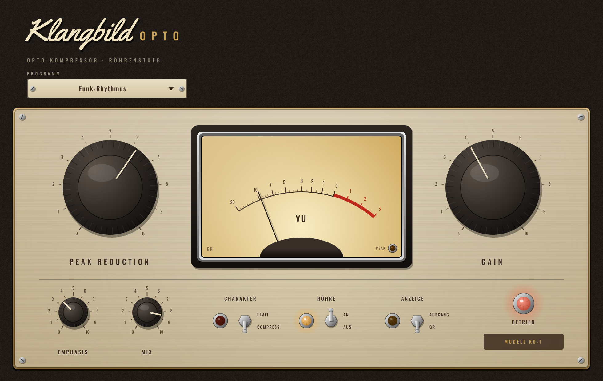

# Klangbild Opto

Opto-Kompressor mit Röhrenstufe – inspiriert von den klassischen Leveling-Amplifiern mit Optozelle.
Wenige Regler, musikalisches „atmendes“ Regelverhalten. Audio Unit für Logic Pro (außerdem VST3 und
Standalone), gebaut mit [JUCE](https://juce.com).



## Bedienung

| Regler | Wirkung |
|---|---|
| **Peak Reduction** | wie stark komprimiert wird (setzt die Schwelle von 0 bis −40 dBFS) |
| **Gain** | Aufholverstärkung nach der Kompression (−10 bis +30 dB) |
| **Charakter** | **Compress** 3:1 mit weichem Knie · **Limit** 10:1 |
| **Emphasis** | hebt die Höhen im Regelweg an (bis +12 dB bei 3 kHz): Höhen werden stärker gebremst, der Bass bleibt offener |
| **Mix** | Parallelkompression: Anteil des komprimierten Signals |
| **Röhre** | leichte Röhrenfärbung (gerade Obertöne) |
| **Anzeige** | VU-Meter zeigt **GR** (Pegelreduktion: Nadel bei 0 = keine Kompression, nach links = mehr) oder den **Ausgang** (0 VU = −18 dBFS) |

**Regelverhalten wie eine Optozelle:** Attack etwa 10 ms, Release zweistufig – nach kurzen Spitzen
erholt sich der Kompressor in ca. ¼ Sekunde, nach längerer Kompression fällt er schnell auf etwa die
Hälfte zurück und gibt dann langsam über 2–3 Sekunden frei. Je länger komprimiert wurde, desto
langsamer die Erholung. Beide Kanäle werden gemeinsam geregelt (Stereobild bleibt stabil).

**Typischer Ablauf:** Peak Reduction aufdrehen, bis die Nadel im GR-Modus bei lauten Stellen
3–6 dB zurückgeht, dann mit Gain den Pegelverlust ausgleichen (Anzeige auf *Ausgang* hilft dabei).

### Presets
Standard · Clean-Gitarre sanft · Funk-Rhythmus · Bass gleichmäßig · Gesang · Parallel dicht · Limiter

### Messwerte (Peak Reduction 50 → Schwelle −20 dBFS)
| Eingang | Compress | Limit |
|---|---|---|
| −15 dBFS | −18,2 dBFS | −19,3 dBFS |
| −10 dBFS | −16,5 dBFS | −18,8 dBFS |
| 0 dBFS | −13,2 dBFS (3:1) | −17,8 dBFS (10:1) |

## Installation in Logic Pro

Tab **Actions** → letzter grüner Lauf → **Artifacts** → `Klangbild-Opto-macOS`, dann:

1. `Klangbild-Opto-AU.zip` entpacken → `Klangbild Opto.component`
2. Finder → ⇧⌘G → `~/Library/Audio/Plug-Ins/Components` → Datei hineinkopieren
3. Einmal im Terminal:
   ```
   xattr -dr com.apple.quarantine ~/Library/Audio/Plug-Ins/Components/"Klangbild Opto.component"
   ```
4. Logic starten: **Audio Units → Klangbild → Klangbild Opto**

## Lizenzen

Schriften *Oswald* (OFL 1.1) und *Yellowtail* (Apache 2.0) – Lizenztexte in `Resources/`.
JUCE: AGPLv3 bzw. kommerziell – für den privaten Gebrauch unproblematisch.
